# DAW Zero — User & Developer Manual

**Version:** 0.5.1  
**Target Hardware:** M5Stack CardputerZero (CM0 / ARM64 Linux, 320 × 170 LCD, 46-key keyboard)  
**Audio / MIDI Stack:** PipeWire + ALSA PCM (Full-Duplex 48 kHz) + ALSA Sequencer (`SND_SEQ_OPEN_DUPLEX`)  
**Release History:** See [CHANGELOG.md](CHANGELOG.md)

---

## 1. Controls & Navigation

### CardputerZero Physical Keyboard
| Key | Action |
|---|---|
| `TAB` / `Shift+TAB` | Next / Previous tab |
| `1` – `6` | Jump directly to tab (`1:TRK`, `2:MIX`, `3:REC`, `4:MID`, `5:AUD`, `6:SES`) |
| `V` or `Q` / `E` | Switch subtabs on **`TRK`** (`CTRL / TIME / WAVE / CLIP`), **`MIX`** (`1:BOARD / 2:STRIP / 3:FX`), **`MID`** (`1:ROUT / 2:MID1 / 3:MID2`), and **`SES`** (`1:PROJ / 2:MON / 3:EXP`) |
| `F` / `X` (or `↑` / `↓`) | Move selection Up / Down (track, row, subtrack `C1–C4`, or channel/Master fader on `MIX → 1:BOARD`) |
| `Z` / `C` (or `←` / `→`) | Adjust value, zoom-proportional scrub/move/trim (`1` → `1/16` beat), or cycle options |
| `U` / `I` | **Horizontal Zoom Out / In** on `TIME`, `WAVE`, `CLIP` (`ALL ↔ 32B ↔ 16B ↔ 8B ↔ 4B`), or **Pan** on `MIX → 1:BOARD` |
| `Alt+U` / `Alt+I` (`[` / `]`) | On `TIME`: set **Loop Start (`[`) / Loop End (`]`)** (or per-track Poly loop length in `Per-Track Poly` mode). On `WAVE` & `CLIP`: **Vertical Amplitude Zoom** (`1x..16x`) |
| `N` | On `TRK → TIME` (`Regions` mode): switch **Loop Region `A → B → C`** (quantized on next bar boundary while playing). On `MID`: toggle `2:MID1 ↔ 3:MID2` |
| `T` | On `TRK → CLIP`: cycle edit tool (`VIEW / SPLIT / MOVE / TRM-L / TRM-R / DUP / JOIN / DEL`). On `TRK → WAVE`: toggle `VIEW` (centered playhead + view scrub) vs `SEEK` |
| `G` | Toggle **Magnetic Object & Grid `SNAP`** ON/OFF on `TRK → TIME / WAVE / CLIP` (snaps to other clips' start/end edges, playhead, loop markers, and bar lines) |
| `B` | Open **MIDI Render / Bounce Overlay** from any channel or subtrack view (`MID 1/2` All or single `C1–C4` → `AUD 1–6` subtrack `C1–C4`, `Master (FX)`, or `Master (Dry)`) |
| `Ctrl+C` / `Ctrl+V` | Copy / Paste selected subtrack `C1–C4` at the playhead (Audio→Audio or MIDI→MIDI) |
| `D` (tap twice) | Fast delete selected **Track** (on `CTRL/TIME/WAVE`) or **Subtrack `C1–C4`** (on `CLIP`) |
| `Ctrl+Z` / `Ctrl+Y` | **16-step Undo / Redo** (also `Ctrl+Shift+Z` for Redo) |
| `ENTER` | Execute row action (Arm, Bypass, Split/Join/Del, Launch Inst, Rename, Save, Export, Rescan) |
| `SPACE` *(tap x2: Jump)* | Play / Stop transport; **double-tap quickly (< 450 ms)** to jump to the start of the active subtrack / zoomed view (or Bar `1.1`) |
| `R` | Start / Stop Recording on armed tracks |
| `A` / `M` / `S` | Arm / Mute / Solo selected track (or `C1–C4` on `CLIP`). On `MIX → 1:BOARD`: **double-click `S`** clears all solos; **double-click `M`** turns all mutes OFF (or all ON if none were muted) |
| `K` | Toggle **Metronome Click** sound (`ON` / `OFF`) globally |
| `L` | Toggle Loop mode |
| `BACKSPACE` | Rewind playhead to Bar `1.1` |
| **Hold/Tap `Alt+M` (`?`) or `H`** | Show context-sensitive 2-column **Help overlay** with all commands for the current view |
| **Hold `ESC` (800 ms)** | Auto-save session cleanly and exit to `APPLaunch` |

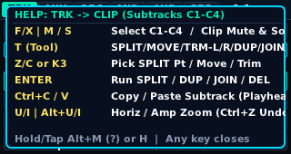

### Alesis V61 MIDI Controller (Dual-Layer Knobs)
On startup, DAW Zero initializes the V61 toggle buttons to **`1: ON`**, **`2: OFF`**, **`3: OFF`**, **`4: OFF`** and keeps LEDs synchronized with transport state:
| Control | CC | **Btn 1 ON (`NAV` Mode — lit)** | **Btn 1 OFF (`ZOOM / MIX` Mode — unlit)** |
|---|---|---|---|
| **Knob 1** | `CC 20` | Switch Tabs (`TRK` → `SES`) | **Timeline Zoom** (`ALL ↔ 32B ↔ 16B ↔ 8B ↔ 4B`) |
| **Knob 2** | `CC 21` | Select Track / Row / Subtrack (`C1–C4`) | **Scroll / Pan Zoomed Window** across song |
| **Knob 3** | `CC 22` | Scrub Playhead / Move Subtrack / Adjust Value (`MIX → 1:BOARD`: Selected Channel Vol) | **Selected Track Volume** *(or FX Param 1 on `MIX → 3:FX`)* |
| **Knob 4** | `CC 23` | Switch Subtabs (`TRK`: sweeps `CTRL → TIME → WAVE → CLIP` + all 7 tools; `MIX`, `MID`, `SES`) | **Master Volume** |
| **Button 1** | `CC 48` | Toggle **`NAV`** (ON) ↔ **`ZOOM / MIX`** (OFF) | *(same)* |
| **Button 2** | `CC 49` | **Play** (ON) / **Stop** (OFF) | *(same)* |
| **Button 3** | `CC 50` | **Record Start** (ON) / **Record Stop** (OFF) | *(same)* |
| **Button 4** | `CC 51` | **Enter / Trigger** (Arm, Split/Join/Del, Bypass) | *(same)* |

---

## 2. Tab-by-Tab Reference

### Tab 1: `TRK` — 4 Subtabs (`CTRL` | `TIME` | `WAVE` | `CLIP`)

| `CTRL` | `TIME` | `WAVE` | `CLIP` |
|:---:|:---:|:---:|:---:|
| 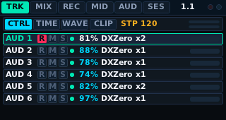 | 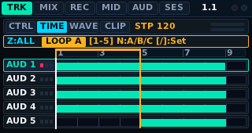 | 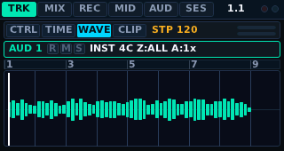 | 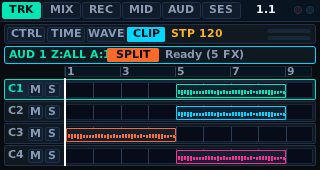 |

Switch between the 4 subtabs anytime on `TRK` using **`V`**, **`Q`/`E`**, or **V61 Knob 4** (in `NAV` mode):
- **`CTRL` (Controls, Source & Volume):**
  - Shows all 8 tracks (`AUD 1–6` in Teal, `MID 1–2` in Magenta) with bright toggled pill badges for **Rec Arm (`R`)**, **Mute (`M`)**, **Solo (`S`)**, a **recorded indicator dot** (`●` + subtrack count `x1..x4`), live **Volume %** (`Z`/`C`), **Source text**, and peak meter.
- **`TIME` (Zoomable Linear Timeline & Live Playhead):**
  - Displays a numbered bar ruler, vertical bar/beat gridlines, colored clip blocks for every Audio & MIDI subtrack (plus a live-growing red bar while recording), and a live vertical **playhead**. Zoom with **`U`/`I`** or **Btn 1 OFF + Knob 1**; scrub literally across the visible window with **Knob 3**.
- **`WAVE` (Selected Track Details & Waveform / Piano-Roll):**
  - Shows full track details (`R`/`M`/`S`, Source, clip count, active FX, zoom level) and a zoomable **56-bar audio waveform** (`AUD 1–6`) or **full-song MIDI piano-roll** (`MID 1–2`) with numbered bar ruler and literal **Knob 3** playhead scrubbing.
- **`CLIP` (4 Stacked Subtracks `C1–C4` for Audio & MIDI):**
  - Works for **both Audio (`AUD 1–6`) and MIDI (`MID 1–2`)** tracks. Every new recording automatically lands in the next free subtrack (`C1→C4`) with zero bleed from existing subtracks.
  - Each clip bar renders a **mini waveform amplitude preview** (Audio) or **note activity preview** (MIDI) inside the bar so you can immediately see where sound starts and peaks, alongside per-subtrack **`M`** (Mute) and **`S`** (Solo) badges toggled via `M` / `S`.
  - Select `C1–C4` (`F`/`X` or Knob 2), switch tools (`T` or `ENTER`):
    - **`SPLIT`** *(first tool)*: Move playhead to exact cut point with **Knob 3** or `Z`/`C`, press **`ENTER`** to slice into a free slot
    - **`MOVE`**: Push/drag subtrack (`Z`/`C` ±1 beat, or literal **Knob 3** across visible window)
    - **`TRM-L` / `TRM-R`**: Non-destructively trim start or finish (`Z`/`C` or Knob 3)
    - **`DUP`**: Duplicate selected subtrack into the next free slot right after it (`ENTER`)
    - **`JOIN`**: Merge only non-muted subtracks (or only soloed subtracks if any are soloed) into a single clip, leaving excluded subtracks untouched (`ENTER`)
    - **`DEL`**: Delete selected subtrack (`ENTER`, or double-tap **`D`** anytime!)
  - Copy & paste subtracks across slots or tracks with **`Ctrl+C` / `Ctrl+V`**, and undo/redo any edit with **16-step `Ctrl+Z` / `Ctrl+Y`**!

### Tab 2: `MIX` — 3 Subtabs (`1:BOARD` | `2:STRIP` | `3:FX`)

| `1:BOARD` — 8-Ch Vertical Mixer | `2:STRIP` — Channel Strip | `3:FX` — Modular DSP Chain |
|:---:|:---:|:---:|
| 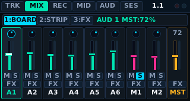 | 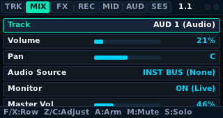 | 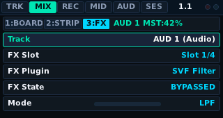 |

Switch between subtabs anytime on `MIX` using **`V`**, **`Q`/`E`**, or **V61 Knob 4 (`NAV` mode)**:

- **`1:BOARD` (9-Strip Vertical Mixer Console: `A1–A6`, `M1–M2`, `MST`):**
  - Displays all 8 channels plus the far-right amber **`MST` Master Volume** strip side-by-side with **top rotary Pan dials**, **vertical Volume sliders**, continuous **30 FPS live peak VU meters** (`teal → amber → red`), and **`M`**, **`S`**, and **`FX`** badges.
  - Select linearly (`A1` → `M2` → `MST`, non-wrapping) with **`Z`/`C`** or **Knob 2**; adjust **Volume / Master Vol** with **`F`/`X`** or **Knob 3**; adjust **Pan** with **`U`/`I`**; toggle **`M` / `S` / `A`** (muting/soloing MIDI channels automatically sends All-Notes-Off so no note ever hangs); press **`ENTER`** to jump straight into **`3:FX`** for that channel (or Master Bus on `MST`).

- **`2:STRIP` (Channel Strip, Input Routing & MIDI Quantize):**
  Select any track linearly from `AUD 1` to `MID 2` (non-wrapping) on row 1 (`Z`/`C` or Knob 3), then configure:
  - **Volume** (`0%` – `150%`, sends CC 7 + scales Note-On velocities on MIDI tracks) and **Pan** (`L100` – `C` – `R100`, sends CC 10 on MIDI tracks).
  - **For Audio Tracks (`AUD 1–6`):**
    - **`Ext Audio In`:** Choose `IN 1 (L)`, `IN 2 (R)`, `IN 1+2 ST`, `INST BUS`, or `OFF`. Displays `[USB]` or `[INT]`.
    - **`Monitor`:** `ON (Live)` routes your live input through the track's FX chain; set `OFF` for hardware direct monitoring.
  - **For MIDI Tracks (`MID 1–2`):**
    - **`MIDI Out`:** Connected hosted instrument (`PianoZero`/`DXZero`) or external USB-MIDI synth port.
    - **`MIDI Thru`:** `ON` forwards live incoming keyboard notes immediately to the target instrument.
    - **`Quantize`:** Non-destructive real-time playback quantization slider (**`OFF`**, **`1/32`**, **`1/16`**, **`1/8T`**, **`1/8`**, **`1/4`**, **`1/2`**, adjustable via `Z`/`C`, `ENTER`, or V61 Knob 3).
  - **Master Vol:** Overall stereo master bus level (with built-in soft limiter).

- **`3:FX` (Modular Filter & Effects Chain):**
  - **Row 0 (`Track`):** Select target track (`AUD 1–6` for 4 insert slots `1/4–4/4`, or `MID 1–2` to target the **Master Bus** `1/2–2/2`).
  - **Row 1 (`FX Slot`):** `Z/C` switches slots.
  - **Row 2 (`FX Plugin`):** `Z/C` cycles through all built-in and external `.so` plugins:
    1. **SVF Filter** (`Mode`: LPF/HPF/BPF/Notch, `Cutoff`, `Reso`, `Drive`)
    2. **Soft Overdrive** (`Drive dB`, `Tone Hz`, `Mix %`)
    3. **Stereo Delay** (`Time ms`, `Fdbk %`, `Damp Hz`, `Mix %`)
    4. **Gain & Utility** (`Gain dB`, `Mono`, `Phase`)
    5. **Warm LPF (.so)** *(example external plugin)* + any custom `.so` plugins you install.
  - **Row 3 (`FX State`):** `ENTER` or `Z/C` toggles `ACTIVE` / `BYPASSED`.
  - **Rows 4+:** Real-time parameter controls with visual bars.
  - Press `DELETE` to clear the current FX slot.

### Tab 3: `REC` — Live Input Monitor & Take Control

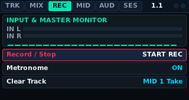

- Displays **IN L / IN R** live capture VU bars and a 24-bar output scope so you can set input gain on your USB interface before recording.
- Quick rows to **Start/Stop Rec**, toggle **Metronome**, or **Clear** the selected track's take.

### Tab 4: `MID` — 3 Subtabs (`1:ROUT` | `2:MID1` | `3:MID2`)

| `1:ROUT` — Routing & Bounce | `2:MID1` — MID 1 Inst & Params | `3:MID2` — MID 2 Inst & Params |
|:---:|:---:|:---:|
| 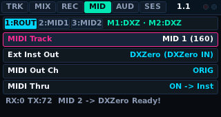 | 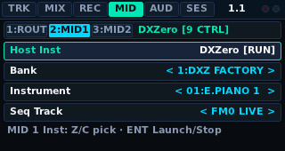 | 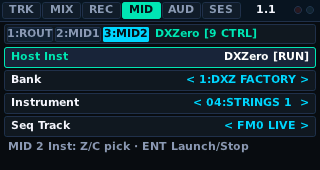 |

Switch between subtabs anytime on `MID` using **`V`**, **`Q`/`E`**, or **V61 Knob 4 (`NAV` mode)** (press **`N`** to quick-toggle `2:MID1 ↔ 3:MID2`):
- **`1:ROUT` (External MIDI Routing & Live Bounce):**
  - Top bar shows both running hosted slots (`M1:DXZ · M2:DXZ`).
  - **`MIDI Track`:** Switch between `MID 1` and `MID 2` (shows `[ARM]` and recorded event count).
  - **`Ext Inst Out`:** `Z/C` cycles all discovered ALSA Sequencer MIDI output ports (`PianoZero`, `DXZero`, or external USB-MIDI keyboards/synths).
  - **`MIDI Out Ch`:** `ORIG` (keep original channel) or force `CH 1–16`.
  - **`MIDI Thru`:** `ON -> Inst` or `OFF`.
  - **`Bounce To`:** Choose the destination audio track (`AUD 1` – `AUD 6`).
  - **`Live Bounce`:** Press `ENTER` to play the MIDI track through its hosted or external instrument while recording its audio directly into the chosen `AUD` track (auto-stops 2 seconds after the last note).
  - **`Rescan MIDI`:** Press `ENTER` after hot-plugging a USB-MIDI instrument to discover its ports and resync V61 LEDs.
- **`2:MID1` & `3:MID2` (Dual Hosted Instruments & Live Parameters):**
  - Run **`PianoZero + DXZero`** or **`2× DXZero`** simultaneously (with an automatic RAM guardrail blocking `2× PianoZero` on 414 MB RAM).
  - **Row 0 (`Host Inst`):** Pick **`None`**, **`PianoZero`**, or **`DXZero`** (`Z`/`C`) and press **`ENTER`** to launch or stop it headlessly for that exact MIDI track! DAW Zero binds each instance to its own ALSA MIDI client ID and Unix control socket (`DAWZERO_CTRL_SOCK`), and automatically saves/restores both running instruments and their patches with the session.
  - **Rows 1+ (Dynamic Controls):** Adjust with **`Z`/`C`** or smoothly sweep with **V61 Knob 3**; toggle/trigger with **`ENTER`**:
    - **`DXZero` exports:** `Bank`, `Instrument` (Patch), `Seq Track`, `Seq Pattern`, `Seq Play`, `Seq Rewind`, `Sync DAW BPM`, `FX Wet Mix`, and `Filter Cutoff`.
    - **`PianoZero` exports:** `Sound Bank`, `Touch Curve`, `Reverb FX`, `Reverb Send`, `Tone Tilt` EQ, `Pedal/Mech`, and `Pedal Level`.

### Tab 5: `AUD` — Audio Interface & Latency Settings

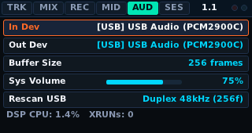

- **`Input Dev`:** Select capture device (`[DEF] Auto (PipeWire)`, `[USB] USB Audio (PCM2900C)`, `[INT] Built-in (ES8389)`, or direct ALSA `[HW-*]`).
- **`Output Dev`:** Select playback device.
- **`Buffer Size`:** `128`, `256`, or `512` frames (`256` frames ≈ 5.3 ms per buffer is a great default for glitch-free duplex recording).
- **`Sys Volume`:** Adjusts PipeWire hardware sink volume.
- **`Rescan USB`:** Press `ENTER` after plugging in a USB audio interface.
- Bottom bar shows live **DSP CPU %** and **XRUN** counter.

### Tab 6: `SES` — 3 Subtabs (`1:PROJ` | `2:MON` | `3:EXP`)

| `1:PROJ` — Sessions & Loop Mode | `2:MON` — Real-Time Health | `3:EXP` — Multi-Format Export |
|:---:|:---:|:---:|
| 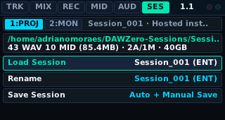 | 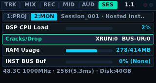 | 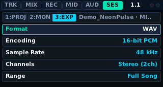 |

Switch between subtabs with **`V`**, **`Q`/`E`**, or **V61 Knob 4 (`CC 23`)**:
- **`1:PROJ` (Project, Loop Mode & Full State Persistence):**
  - Displays the active session directory (`~/DAWZero-Sessions/<SessionName>/`), live file summary (`WAV` / `MID` counts, active track counts, total session MB, free microSD GB).
  - **Full Auto-Save & Auto-Restore:** Sessions auto-save on session switch, instrument launch, recording stop, and clean exit (`Hold ESC`), persisting all WAV/MIDI clips, per-subtrack Mute/Solo, Track & Master FX chains, Loop Mode & regions, MIDI Quantize, and running hosted instruments (`MID 1` / `MID 2`) + patches.
  - Actions: **`Load Session`**, **`Loop Mode`** (`Regions (A/B/C)` vs `Per-Track Poly`), **`Rename`**, **`Save Session`**, **`Export Audio`** (jumps to `3:EXP`), **`New Session`**, and **`Rescan .so FX`**.
- **`2:MON` (Real-Time Audio & Hardware Health Monitor):**
  - **DSP CPU Load %**, **Cracks/Drop (`XRUN` / `BUS-UR`)** (`ENTER` resets), **RAM Usage**, **`INST BUS` Buffer** (showing both hosted slots e.g. `DXZ+DXZ`), and **Hardware Telemetry** (CPU temp, clock, latency, free disk).
- **`3:EXP` (Configurable Audio Export & Mixdown):**
  - Configure **Format** (`WAV`, `FLAC`, `MP3`, `OGG`, `OPUS`), **Encoding / Bitrate** (`16/24/32-bit Float` WAV, `16/24-bit` FLAC, `128–320 kbps` MP3/OGG/OPUS), **Sample Rate** (`48 kHz` / `44.1 kHz`), **Channels** (`Stereo` / `Mono`), **Range** (`Full Song` or `Loop [start–end]`), **Loop Repeats** (`1x`–`8x`), **FX Tail** (`0s` / `2s` / `4s`), **Apply FX** (`ON` / `OFF`), **Normalize** (`OFF` / `-1.0 dB` / `-0.3 dB`), and **Export Mode** (`Mixdown Only` or `Mix + Stems`). Press **`ENTER`** on **`Export Now`** to render into `~/DAWZero-Sessions/<Session>/`.

---

## 3. Core Workflows

### A. Recording an External Digital Instrument into an Audio Track
1. Connect your digital keyboard's audio output to your USB audio interface (or CardputerZero 3.5 mm TRRS input).
2. Open **`AUD`** (`5`) and confirm `Input Dev` is your USB interface (or `Auto (PipeWire)`).
3. Open **`MIX → 2:STRIP`** (`2`), select `AUD 1`, set `Ext Audio In` to `IN 1 (L)`, `IN 2 (R)`, or `IN 1+2 ST`, and set `Monitor` to `ON (Live)` if you want to hear it through **`FX`**.
4. Switch to **`MIX → 3:FX`** (`V` or `E`) to insert a filter/effect on `AUD 1` (optional — FX are non-destructive on playback and monitoring, so your raw recording stays clean!).
5. Press `A` to arm `AUD 1`, press `R` (or V61 Btn 3) to start recording, play your instrument, and press `R` or `SPACE` to stop.

### B. Multitrack Overdubbing (Parallel Playback + Recording)
1. After recording `AUD 1`, press `BACKSPACE` to rewind to `1.1`.
2. In **`TRK`** (`1`), disarm `AUD 1` (`A`), move down to `AUD 2` (`X`), and arm `AUD 2` (`A`).
3. Press `R` to record `AUD 2` — **`AUD 1` plays back in parallel** while you record `AUD 2` sample-aligned!
4. Repeat across `AUD 1–6` and `MID 1–2`. You can also punch-in mid-song without rewinding; each clip stores its exact `start_frame` offset.

### C. Generating an Audio Track from a MIDI Track (`Live Bounce`)
1. Connect your external digital keyboard via **USB-MIDI** (for notes) and **Audio** (into your USB audio interface).
2. Arm `MID 1` (`A`), record your MIDI performance (`R`), and stop.
3. Open **`MID`** (`4`), set `Ext Inst Out` to your digital keyboard, pick `Bounce To: AUD 3` (any free audio track), and press `ENTER` on **`Live Bounce`**.
4. DAW Zero rewinds to `1.1`, sends `MID 1` to your external digital keyboard, records its audio into `AUD 3`, and automatically stops 2 seconds after the last note. `AUD 3` is now a full audio track ready for mixing and **`FX`**!

---

## 4. Developing Your Own Filters & Effects (`.so` Plugins)

Every filter or effect you create only needs a single C/C++ file implementing `daw_plugin_api.h`.

1. Copy the template:
   ```bash
   cp plugins/example_lpf/example_lpf.cpp plugins/my_filter.cpp
   ```
2. Implement `create`, `destroy`, `reset`, `set_param`, `get_param`, `process_stereo`, and export:
   ```cpp
   extern "C" const DawPluginDesc *dawzero_plugin_descriptor(void);
   ```
3. Compile directly on the CardputerZero:
   ```bash
   g++ -O3 -mcpu=cortex-a53 -shared -fPIC -I main/include \
       plugins/my_filter.cpp -o my_filter.so -lm
   ```
4. Install into your user plugin folder:
   ```bash
   mkdir -p ~/.config/daw-zero/plugins
   cp my_filter.so ~/.config/daw-zero/plugins/
   ```
5. In DAW Zero, go to **`SES` → `Rescan .so FX`** (or restart DAW Zero) and select your new effect in **`FX`**!
