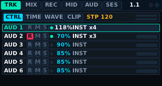
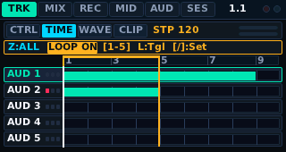
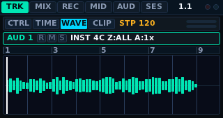
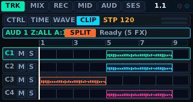
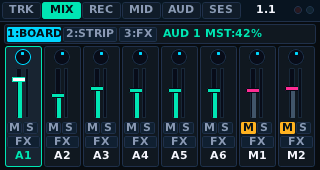
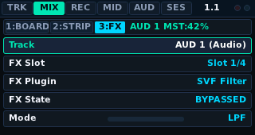
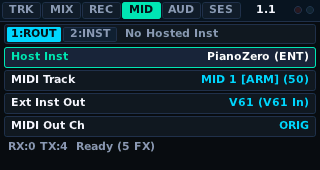
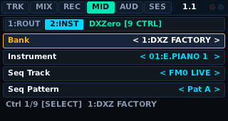
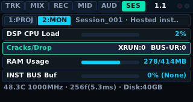

<div align="center">


# CardputerZero DAW Zero

**Lightweight Multitrack Audio & MIDI Pocket DAW for M5Stack CardputerZero (`APPLaunch`)**

*Created by **Adriano Dias Moraes***

[](releases/v0.4.2/daw-zero_0.4.2-m5stack1_arm64.deb)
[-FF8C00?style=for-the-badge)](#installation)
[](MANUAL.md)
[](CHANGELOG.md)

</div>

---

## Overview

**CardputerZero DAW Zero** turns the pocket-sized **M5Stack CardputerZero** (`320×170` IPS display, 46-key matrix keyboard, ARM64 Linux) into a real-time **8-track Audio & MIDI Pocket DAW** (6 Audio + 2 MIDI tracks, 4 stacked subtracks `C1–C4` each) built on LVGL 9.5 Neon UI.

Record external instruments over USB audio interfaces (e.g., M-Audio M-Track Duo / `PCM2900C`) or the built-in `ES8389` codec, host **PianoZero** and **DXZero** headlessly over a virtual PipeWire `INST BUS` with live parameter control inside `MID → 2:INST`, edit clips with 16-step `Ctrl+Z`/`Ctrl+Y` Undo & Redo, stack modular `.so` DSP effects, and export Ardour-compatible WAV/MIDI stems and stereo mixdowns.

<div align="center">

| `TRK → CTRL` — 8-Track Console | `TRK → TIME` — Multitrack Timeline | `TRK → WAVE` — Waveform & Ruler |
|:---:|:---:|:---:|
|  |  |  |
| **`TRK → CLIP` — 4 Subtracks (`C1–C4`)** | **`MIX → 1:BOARD` — 8-Ch Mixer** | **`MIX → 3:FX` — Modular DSP Chain** |
|  |  |  |
| **`MID → 1:ROUT` — Hosted Inst & Bounce** | **`MID → 2:INST` — Live Inst Controls** | **`SES → 2:MON` — Real-Time Monitor** |
|  |  |  |

</div>

---

## Releases & Downloads

| Version | Release Date | Package (ARM64 Debian) | Checksum | Notes |
|---|---|---|---|---|
| **`v0.4.2`** | 2026-11-27 | [`daw-zero_0.4.2-m5stack1_arm64.deb`](releases/v0.4.2/daw-zero_0.4.2-m5stack1_arm64.deb) | [`SHA256SUMS.txt`](releases/v0.4.2/SHA256SUMS.txt) | **3-subtab `MIX` Console (`1:BOARD` vertical 8-ch mixer / `2:STRIP` / `3:FX`)**, **6-tab top ribbon**, **`TRK → TIME` loop markers (`Alt+U`/`Alt+I`, `L`) + multi-take loop recording (`C1→C4`)**, **V61 Knob 4 continuous subtab + tool sweep**, **selective `JOIN` (soloed / non-muted)**, and **clamped linear `MIX` track selection** — see [CHANGELOG.md](CHANGELOG.md) |
| **`v0.4.1`** | 2026-11-26 | [`daw-zero_0.4.1-m5stack1_arm64.deb`](releases/v0.4.1/daw-zero_0.4.1-m5stack1_arm64.deb) | [`SHA256SUMS.txt`](releases/v0.4.1/SHA256SUMS.txt) | **Subtrack `Ctrl+C`/`Ctrl+V` copy/paste**, **`DUP` duplicate tool**, **`SPLIT` as first tool**, **2-column yellow/white Help overlay**, and **pixel-exact proportional waveform scaling under zoom** — see [CHANGELOG.md](CHANGELOG.md) |
| **`v0.4.0`** | 2026-11-25 | [`daw-zero_0.4.0-m5stack1_arm64.deb`](releases/v0.4.0/daw-zero_0.4.0-m5stack1_arm64.deb) | [`SHA256SUMS.txt`](releases/v0.4.0/SHA256SUMS.txt) | **Sequencer BPM Auto-Sync** (`BPM\|<val>`), **mini waveform & MIDI previews + per-subtrack `M`/`S`** in `TRK → CLIP`, **vertical amplitude zoom** (`Alt+U/I`, `1x–16x`) + taller `WAVE`, **footer-free UI + Help overlay** (`Alt+M` `?` / `Fn+H` / `H`), **global `K` Click toggle**, **click-free adaptive `INST BUS` resampler**, and **multi-track `Bounce To` auto-routing** — see [CHANGELOG.md](CHANGELOG.md) |
| **`v0.3.0`** | 2026-11-25 | [`daw-zero_0.3.0-m5stack1_arm64.deb`](releases/v0.3.0/daw-zero_0.3.0-m5stack1_arm64.deb) | [`SHA256SUMS.txt`](releases/v0.3.0/SHA256SUMS.txt) | Initial public `.deb` release — 8 tracks × 4 stacked subtracks (`C1–C4`), 16-step Undo/Redo, timeline zoom (`U`/`I` & dual-layer Alesis V61 knobs), hosted `PianoZero`/`DXZero` via `INST BUS` + universal `DAWZERO_CTRL_SOCK` (`MID → 2:INST`), modular `.so` DSP FX host (`example_lpf.so` included), and neon launcher icon — see [CHANGELOG.md](CHANGELOG.md) |

---

## Installation

No compiler or build tools required. Install the prebuilt ARM64 `.deb` package directly on your M5Stack CardputerZero:

### Option 1: Install Directly on CardputerZero
Download the `.deb` package to your CardputerZero and run:
```bash
sudo apt install -y ./daw-zero_0.4.2-m5stack1_arm64.deb
```

### Option 2: Install Remotely Over SSH (from macOS / Linux / Windows)
```bash
scp releases/v0.4.2/daw-zero_0.4.2-m5stack1_arm64.deb <user>@<cardputer-ip>:/tmp/
ssh <user>@<cardputer-ip> "sudo apt install -y /tmp/daw-zero_0.4.2-m5stack1_arm64.deb"
```

After installation, **DAW Zero** appears automatically in the CardputerZero **`APPLaunch`** launcher with its neon icon.

### Verify Package Integrity (Optional)
```bash
cd releases/v0.4.2
sha256sum -c SHA256SUMS.txt
```

### Uninstall
```bash
sudo apt remove daw-zero
```
*(Your saved sessions in `~/DAWZero-Sessions/` and custom `.so` plugins in `~/.config/daw-zero/plugins/` are preserved.)*

---

## Documentation
- **[MANUAL.md](MANUAL.md)** — Complete operating guide, keyboard & dual-layer Alesis V61 reference, subtrack editing, hosted instruments & Live Bounce workflows, and custom `.so` DSP plugin authoring guide.
- **[CHANGELOG.md](CHANGELOG.md)** — Full version history and release notes.

## License
MIT — Adriano Dias Moraes
